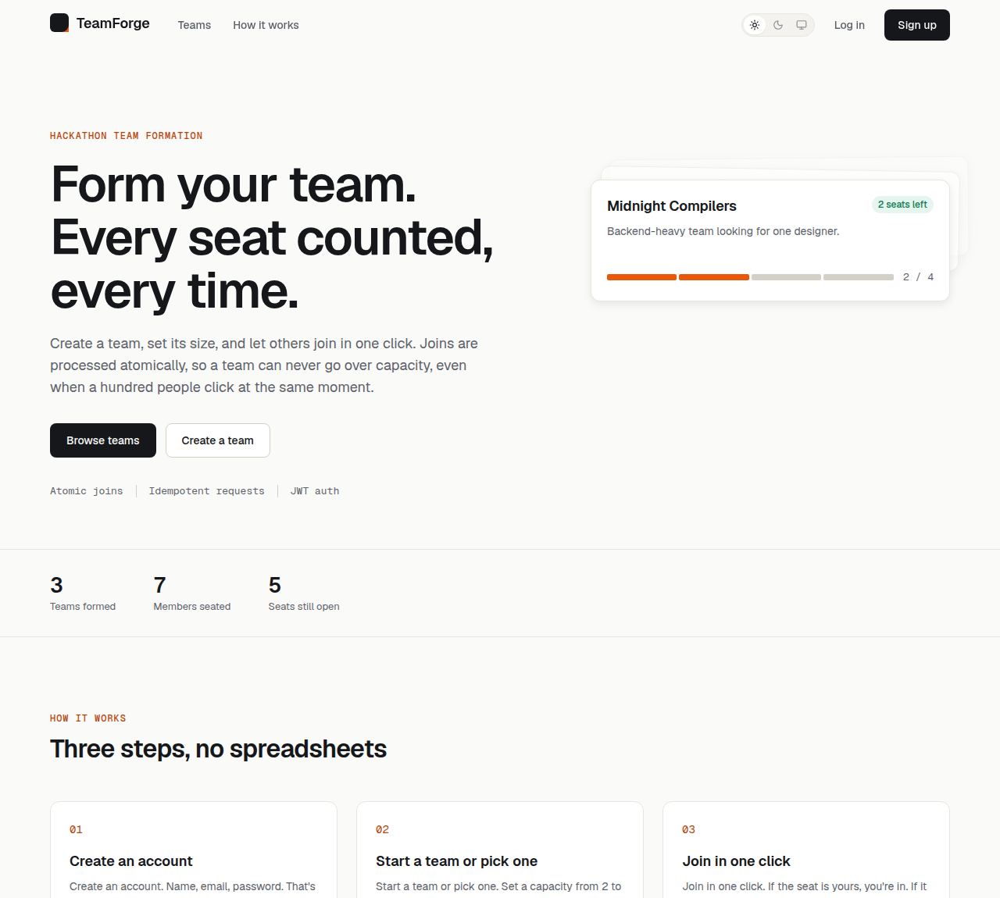
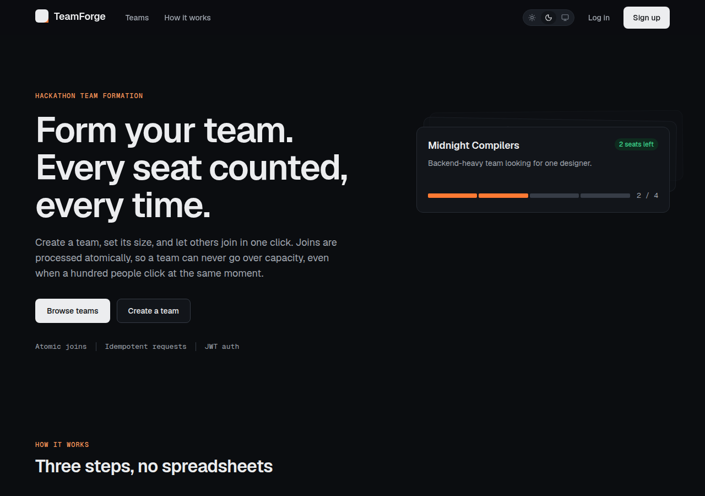
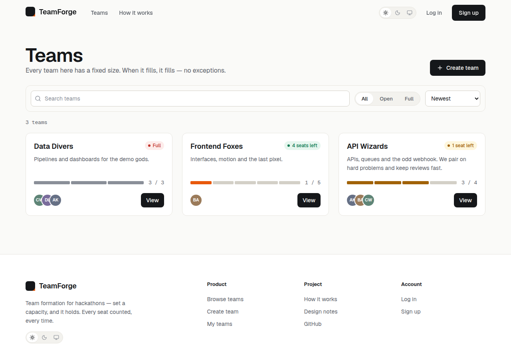
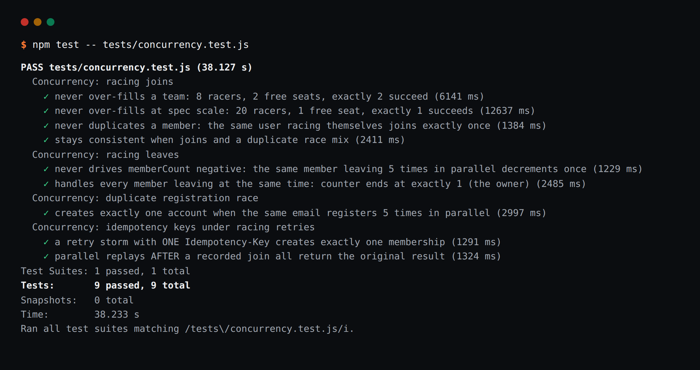

<p align="center"></p>

# Hack4Hack PS1 — Race-Proof Team Formation Platform

A team-formation platform for hackathons where **concurrent join/create
operations can never corrupt state**: a team can never exceed its capacity and
a user can never end up in the same team twice — even when many requests hit
the server at exactly the same moment.

Built for the **Hack4Hack Crew Hiring Challenge 2026, Problem Statement 1**.

## Live demo

- **Web app:** https://hack4hack-web.vercel.app
- **API:** https://hack4hack-api.vercel.app (health check: `/api/health`)
- Log in with any demo account from §5 below (password `demo1234`).

Deployed Nov 13, 2026, entirely on free tiers: the API runs as Vercel
serverless functions pinned to Mumbai (`bom1`), next to the database on
MongoDB Atlas (M0); the client is a Vercel static build.

## Screenshots

The UI follows a written design system (Geist type, neutral surfaces,
one ember accent) with light, dark and system themes.







## Why this is interesting

The naive way to add a member is:

1. Read the team.
2. Check `members.length < capacity`.
3. Push the new member and save.

Two requests doing this at the same time both pass step 2 and both push —
the team ends up over capacity. That is a classic **race condition**
(check-then-act is not atomic).

This project fixes it by making the check and the write **one atomic database
operation** (see `DESIGN.md` for the full explanation).

## Features

- **Race-proof joins** — capacity is enforced inside the atomic write
  itself (`$expr` against the document's own capacity), so concurrent
  joins, leaves and owner capacity edits can never over-fill a team.
- **Idempotent requests** — every join carries an `Idempotency-Key`;
  retries and double-clicks replay the original outcome instead of
  joining twice, even mid-flight.
- **Sessions done properly** — 15-minute access JWTs plus rotating,
  revocable refresh tokens (httpOnly cookie, SHA-256 hashed at rest).
- **Brute-force protection** — per-IP rate limits (spec-literal: every
  auth request counts) and a per-account lockout: 5 failed logins lock
  the account for 15 minutes, always behind the same generic error.
- **Join approvals & invite codes** — owners can require approval
  before a seat is taken, and every team has a private invite code
  (owner-visible only) that joins through the same pipeline.
- **Settings** — display name, theme preference (light / dark / system,
  no flash on load), and "sign out everywhere".
- **Audit log** — create / join / leave / delete are recorded with
  actor and timestamp.
- **One-team-per-user** rule available behind an environment flag
  (`ONE_TEAM_PER_USER`), off by default.

## Tech stack

| Layer    | Choice                              |
| -------- | ----------------------------------- |
| Frontend | React (Vite) — design system, light/dark themes |
| Backend  | Node.js + Express                   |
| Database | MongoDB + Mongoose                  |
| Auth     | 15-min access JWT + rotating refresh-token cookie (httpOnly, hashed at rest) |
| Tests    | Jest + Supertest + mongodb-memory-server |
| CI       | GitHub Actions                      |
| Load test| Artillery (config + results in `load/`) |

## Project layout

```
hack4hack/
├── server/            Express API (src: config, models, routes, controllers, middleware)
│   └── tests/         Jest + Supertest API tests
├── client/            React (Vite) frontend
├── load/              Artillery load test: config, prepare/processor, local runner + results
├── DESIGN.md          Design doc: data model, race strategy, API, testing, load test
└── BUILD-PLAN.md      Day-by-day build plan (Nov 11 → Nov 15)
```

## How to run

### 1. Database

You need a MongoDB connection string. Easiest options:

- **MongoDB Atlas** free tier (used for deployment), or
- a local `mongod`, or
- Docker: `docker run -d -p 27017:27017 mongo`

### 2. Server

```bash
cd server
cp .env.example .env     # then fill in MONGO_URI and JWT_ACCESS_SECRET
npm install
npm run dev              # http://localhost:4000
```

### 3. Client

```bash
cd client
cp .env.example .env     # VITE_API_URL points at the live API; for local
                         # development set it to http://localhost:4000
npm install
npm run dev              # http://localhost:5173
```

### 4. Tests

```bash
cd server
npm test
```

**94 API tests, all passing** — happy paths, edge cases (duplicate email
`409`, forged/missing tokens `401`, deleted-team `404`s, capacity
boundaries), the contract suite (search/filter/pagination, owner edits,
stats), the security suite (helmet, CORS allowlist, rate limits), the
session suite (refresh rotation, logout revocation), settings
(name change, sign-out-everywhere), the lockout suite (5 failed logins
lock the account), join approvals and invite codes — plus the
concurrency suite that proves the race-proofing: join/leave stampedes
(20 racers for 1 seat; 50 racers for 4 seats), duplicate-registration
races, and idempotency-key retry storms. The client adds **12 component
tests** (Vitest + Testing Library) for the seat meter and the join
button's state machine (`cd client && npm test`).



The tests do **not** need a running MongoDB — they use
`mongodb-memory-server`, which starts a throwaway in-memory MongoDB,
runs the suite against the real Express app, and tears it down.

### 5. Seed demo data (optional)

```bash
cd server
npm run seed        # WARNING: wipes the database first, then seeds it
```

Creates the demo users and teams below so the app — and the demo video —
can be explored immediately: one team is full, the others have free seats.

#### Demo accounts

All six accounts use the same throwaway password: **`demo1234`**
(fake accounts created by the seed script for this hackathon demo —
not real credentials).

| Name             | Email               |
| ---------------- | ------------------- |
| Ayesha Khan      | ayesha@example.com  |
| Bilal Ahmed      | bilal@example.com   |
| Chen Wei         | chen@example.com    |
| Dana Petrova     | dana@example.com    |
| Elias Rodriguez  | elias@example.com   |
| Fatima Noor      | fatima@example.com  |

### 6. Load test

```bash
node load/run-local.js   # one command: in-memory DB + API + Artillery
```

Latest **local** run (Nov 11, 2026; API, in-memory MongoDB and Artillery
all sharing one small dev VM): 2,029 requests at ~52 req/s — 1,667 × 200,
362 × 409 (the stampede's losing joins, by design), **zero errors**,
**p95 = 10.1 ms** against the PS1 target of p95 < 200 ms.
Full numbers in `load/results-local.txt`; how it works in `load/README.md`.

**Live run** (Nov 13, 2026, against the deployed API): the reduced profile
answered **306 of 306 requests with zero 5xx errors** — the stampede joins
beyond capacity all returned a correct 409 and the team did not over-fill.
The full-intensity profile saturated the load generator's own network path
before it could stress the API; both runs, with their conditions, are
recorded honestly in `load/results-live.txt`.

## API summary

| Method | Endpoint              | Auth | Description                          |
| ------ | --------------------- | ---- | ------------------------------------ |
| POST   | `/api/auth/register`  | –    | Create an account (access JWT + refresh cookie) |
| POST   | `/api/auth/login`     | –    | Log in (one generic error for bad credentials) |
| POST   | `/api/auth/refresh`   | cookie | Rotate the refresh token, get a fresh access JWT |
| POST   | `/api/auth/logout`    | cookie | Revoke the refresh token, clear the cookie |
| GET    | `/api/auth/me`        | JWT  | Current user                         |
| GET    | `/api/health`         | –    | Health check (status, uptime, db)    |
| GET    | `/api/stats`          | –    | Live counts: teams, members, open seats |
| POST   | `/api/teams`          | JWT  | Create a team (creator = owner, member #1) |
| GET    | `/api/teams`          | –    | List teams — search, status filter, sort, pagination |
| GET    | `/api/teams/mine`     | JWT  | Your teams (`?role=joined\|created`) |
| GET    | `/api/teams/:id`      | –    | One team                             |
| PATCH  | `/api/teams/:id`      | JWT  | Edit a team (owner only; capacity never below member count) |
| POST   | `/api/teams/:id/join` | JWT  | **Join a team (race-proof)** — requires an `Idempotency-Key` (UUID) header |
| DELETE | `/api/teams/:id/leave`| JWT  | Leave a team                         |
| DELETE | `/api/teams/:id`      | JWT  | Delete a team (owner only)           |

## The race-proof guarantee

`POST /teams/:id/join` performs a **single atomic conditional update**:

```js
Team.findOneAndUpdate(
  {
    _id: teamId,
    $expr: { $lt: ['$memberCount', '$capacity'] }, // still has a free seat
    'members.user': { $ne: userId },               // not already a member
  },
  {
    $push: { members: { user: userId, role: 'member' } },
    $inc: { memberCount: 1 },
  },
  { new: true }
);
```

The seat check compares the counter against the team's **own capacity
field inside the same atomic operation** (`$expr`) — never against a
value read earlier in JavaScript — so even an owner editing the team's
capacity a millisecond before a join cannot open a stale-limit window.

MongoDB guarantees that one update on one document is atomic: the conditions
and the write succeed or fail **together**. Two racing requests are
serialised by the database — the second one re-evaluates the conditions
against the already-updated document and fails instead of over-filling the
team. No locks, no transactions, no replica set required — it works on any
MongoDB deployment. Full reasoning in `DESIGN.md`.
